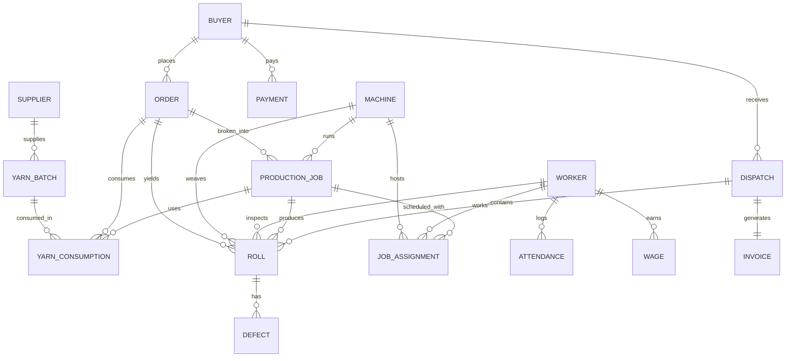

# Loomdo — System Architecture & Design Specification
**Tagline:** "Every roll, traced from yarn to invoice."  
**Event:** Odoo x NMIT Bangalore Hackathon 2026  
**Demo Client:** Everest Textile Mills  

---

## 1. System Architecture Overview

Loomdo follows a modular, decoupled, offline-first client-server architecture:
```
+-----------------------------------------------------------------------------------+
|                            CLIENT: REACT 18 (VITE)                                |
|  - Tailwind CSS (#714B67 Purple / #5BC8B0 Teal)  - Local Offline Fonts & Icons    |
|  - Reusable Component Kit (Card, Table, Badge, FormField, Modal, Toast)           |
|  - 11-Module Sidebar Shell   - Public Tracking View  - Roll Passport (Offline QR) |
|  - Mobile Mill-Floor Touch Mode  - Bilingual Engine (EN / TA)                     |
+-----------------------------------------------------------------------------------+
                                        |  REST API (JSON over HTTP)
                                        v  Auto-docs at /docs
+-----------------------------------------------------------------------------------+
|                           SERVER: FASTAPI (PYTHON 3.10+)                          |
|  - Pydantic v2 Validation DTOs  - Explainable Rule Engines                        |
|  - Routers: Inventory, Production, QC, Orders, Dispatch, Workforce, Costing,      |
|             Insights, FloorMap, Settings, Simulation                              |
|  - Audit Trail Interceptor      - Odoo CSV Export Generator                       |
+-----------------------------------------------------------------------------------+
                                        |  SQLAlchemy 2.0 ORM
                                        v  WAL Mode Transactions
+-----------------------------------------------------------------------------------+
|                        DATABASE: SQLITE 3 (LOCAL FILE)                            |
|  - loomdo.db (ACID Transactions, Foreign Keys Enforced, Atomic Roll Locks)        |
|  - Virtual / Derived Views: Finished Stock (Rolls WHERE qc_status='pass')         |
+-----------------------------------------------------------------------------------+
```

### 1.1 Key Architectural Decisions
1. **Offline-First Zero-External Asset Pipeline:**
   - Fonts: Standard system sans-serif / bundled Inter font via `@fontsource/inter`.
   - Icons: `lucide-react` bundled locally via npm (no icon fonts or external CDNs).
   - QR Codes: Pure client-side canvas generation using `qrcode.react` (zero external QR APIs).
2. **Deterministic Explainability:**
   - Every KPI, grade calculation, delay assessment, and cost aggregation is computed through deterministic Python logic. Zero non-deterministic models or external heuristics.
3. **Derived Finished Stock Principle:**
   - **No separate `FinishedGoods` table.** Finished stock is dynamically derived from `Rolls` where `qc_status = 'pass'` and `dispatched = false`. This guarantees 100% data consistency between quality inspection, warehouse shelves, and dispatches.

---

## 2. Database Schema & Data Model

SQLite foreign keys are enabled via PRAGMA `foreign_keys = ON;` and WAL mode via `PRAGMA journal_mode = WAL;`.



### 2.1 Table Definitions

#### Master Tables
```sql
CREATE TABLE suppliers (
    id INTEGER PRIMARY KEY AUTOINCREMENT,
    name TEXT NOT NULL,
    contact TEXT NOT NULL,
    phone TEXT NOT NULL,
    city TEXT NOT NULL,
    created_at TIMESTAMP DEFAULT CURRENT_TIMESTAMP
);

CREATE TABLE buyers (
    id INTEGER PRIMARY KEY AUTOINCREMENT,
    name TEXT NOT NULL,
    contact TEXT NOT NULL,
    phone TEXT NOT NULL,
    city TEXT NOT NULL,
    credit_limit REAL NOT NULL DEFAULT 500000.0,
    created_at TIMESTAMP DEFAULT CURRENT_TIMESTAMP
);

CREATE TABLE machines (
    id INTEGER PRIMARY KEY AUTOINCREMENT,
    name TEXT NOT NULL UNIQUE,
    stage TEXT NOT NULL CHECK(stage IN ('spinning', 'weaving', 'dyeing')),
    status TEXT NOT NULL DEFAULT 'idle' CHECK(status IN ('running', 'idle', 'breakdown')),
    capacity_m_per_hour REAL NOT NULL,
    floor_x REAL NOT NULL,
    floor_y REAL NOT NULL,
    status_updated_at TIMESTAMP DEFAULT CURRENT_TIMESTAMP
);

CREATE TABLE workers (
    id INTEGER PRIMARY KEY AUTOINCREMENT,
    name TEXT NOT NULL,
    role TEXT NOT NULL,
    skill_level TEXT NOT NULL CHECK(skill_level IN ('trainee', 'semi_skilled', 'skilled', 'master')),
    hourly_rate REAL NOT NULL,
    overtime_multiplier REAL NOT NULL DEFAULT 1.5,
    default_shift TEXT NOT NULL CHECK(default_shift IN ('morning', 'evening', 'night'))
);

CREATE TABLE settings (
    key TEXT PRIMARY KEY,
    value TEXT NOT NULL,
    description TEXT,
    updated_at TIMESTAMP DEFAULT CURRENT_TIMESTAMP
);
```

#### Yarn and Orders
```sql
CREATE TABLE yarn_batches (
    id INTEGER PRIMARY KEY AUTOINCREMENT,
    batch_code TEXT NOT NULL UNIQUE,
    supplier_id INTEGER NOT NULL REFERENCES suppliers(id),
    yarn_type TEXT NOT NULL,
    colour TEXT NOT NULL,
    kg_received REAL NOT NULL CHECK(kg_received > 0),
    kg_remaining REAL NOT NULL CHECK(kg_remaining >= 0),
    cost_per_kg REAL NOT NULL CHECK(cost_per_kg > 0),
    linked_order_id INTEGER REFERENCES orders(id),
    received_at TIMESTAMP DEFAULT CURRENT_TIMESTAMP,
    received_by TEXT NOT NULL
);

CREATE TABLE orders (
    id INTEGER PRIMARY KEY AUTOINCREMENT,
    order_number TEXT NOT NULL UNIQUE,
    buyer_id INTEGER NOT NULL REFERENCES buyers(id),
    fabric_type TEXT NOT NULL,
    colour TEXT NOT NULL,
    quantity_m REAL NOT NULL CHECK(quantity_m > 0),
    deadline DATE NOT NULL,
    price_per_m REAL NOT NULL CHECK(price_per_m > 0),
    status TEXT NOT NULL DEFAULT 'Created' CHECK(status IN (
        'Created', 'Yarn reserved', 'Spinning', 'Weaving', 'Dyeing', 'QC', 'Ready', 'Dispatched'
    )),
    yarn_required_kg REAL NOT NULL CHECK(yarn_required_kg > 0),
    expected_delivery DATE NOT NULL,
    created_at TIMESTAMP DEFAULT CURRENT_TIMESTAMP
);

CREATE TABLE production_jobs (
    id INTEGER PRIMARY KEY AUTOINCREMENT,
    order_id INTEGER NOT NULL REFERENCES orders(id),
    machine_id INTEGER NOT NULL REFERENCES machines(id),
    stage TEXT NOT NULL CHECK(stage IN ('spinning', 'weaving', 'dyeing')),
    progress_pct REAL NOT NULL DEFAULT 0.0 CHECK(progress_pct BETWEEN 0.0 AND 100.0),
    output_today_m REAL NOT NULL DEFAULT 0.0 CHECK(output_today_m >= 0),
    shift TEXT NOT NULL CHECK(shift IN ('morning', 'evening', 'night')),
    operator_id INTEGER NOT NULL REFERENCES workers(id),
    started_at TIMESTAMP DEFAULT CURRENT_TIMESTAMP,
    completed_at TIMESTAMP
);

CREATE TABLE yarn_consumptions (
    id INTEGER PRIMARY KEY AUTOINCREMENT,
    yarn_batch_id INTEGER NOT NULL REFERENCES yarn_batches(id),
    production_job_id INTEGER NOT NULL REFERENCES production_jobs(id),
    order_id INTEGER NOT NULL REFERENCES orders(id),
    kg_issued REAL NOT NULL CHECK(kg_issued > 0),
    kg_returned REAL NOT NULL DEFAULT 0.0 CHECK(kg_returned >= 0),
    issued_at TIMESTAMP DEFAULT CURRENT_TIMESTAMP
);
```

#### Rolls and Quality
```sql
CREATE TABLE rolls (
    id INTEGER PRIMARY KEY AUTOINCREMENT,
    roll_number TEXT NOT NULL UNIQUE,
    order_id INTEGER NOT NULL REFERENCES orders(id),
    machine_id INTEGER NOT NULL REFERENCES machines(id),
    yarn_batch_id INTEGER NOT NULL REFERENCES yarn_batches(id),
    production_job_id INTEGER NOT NULL REFERENCES production_jobs(id),
    dye_lot TEXT NOT NULL,
    shade_value TEXT NOT NULL,
    length_m REAL NOT NULL CHECK(length_m > 0),
    width_in REAL NOT NULL CHECK(width_in > 0),
    shift TEXT NOT NULL CHECK(shift IN ('morning', 'evening', 'night')),
    operator_id INTEGER NOT NULL REFERENCES workers(id),
    qc_status TEXT NOT NULL DEFAULT 'pending' CHECK(qc_status IN ('pending', 'pass', 'rework', 'reject')),
    grade TEXT CHECK(grade IN ('A', 'B', 'reject') OR grade IS NULL),
    defect_points INTEGER DEFAULT 0,
    inspected_area_sq_yd REAL DEFAULT 0.0,
    dispatched BOOLEAN NOT NULL DEFAULT 0,
    dispatch_id INTEGER REFERENCES dispatches(id),
    created_at TIMESTAMP DEFAULT CURRENT_TIMESTAMP
);
CREATE INDEX idx_rolls_qc_dispatch ON rolls (qc_status, dispatched);
CREATE INDEX idx_rolls_order ON rolls (order_id);
CREATE INDEX idx_rolls_dye_lot ON rolls (dye_lot);

CREATE TABLE defects (
    id INTEGER PRIMARY KEY AUTOINCREMENT,
    roll_id INTEGER NOT NULL REFERENCES rolls(id) ON DELETE CASCADE,
    type TEXT NOT NULL CHECK(type IN ('hole', 'colour_mismatch', 'uneven_weave', 'stain', 'other')),
    size_in REAL NOT NULL CHECK(size_in > 0),
    points INTEGER NOT NULL CHECK(points BETWEEN 1 AND 4),
    created_at TIMESTAMP DEFAULT CURRENT_TIMESTAMP
);
```

#### Dispatch and Financials
```sql
CREATE TABLE dispatches (
    id INTEGER PRIMARY KEY AUTOINCREMENT,
    dispatch_number TEXT NOT NULL UNIQUE,
    buyer_id INTEGER NOT NULL REFERENCES buyers(id),
    vehicle_no TEXT NOT NULL,
    notes TEXT,
    dispatched_at TIMESTAMP DEFAULT CURRENT_TIMESTAMP,
    created_by TEXT NOT NULL
);

CREATE TABLE invoices (
    id INTEGER PRIMARY KEY AUTOINCREMENT,
    dispatch_id INTEGER NOT NULL UNIQUE REFERENCES dispatches(id),
    buyer_id INTEGER NOT NULL REFERENCES buyers(id),
    invoice_no TEXT NOT NULL UNIQUE,
    subtotal REAL NOT NULL,
    tax REAL NOT NULL,
    total REAL NOT NULL,
    status TEXT NOT NULL DEFAULT 'unpaid' CHECK(status IN ('unpaid', 'paid', 'partial')),
    issued_at TIMESTAMP DEFAULT CURRENT_TIMESTAMP
);

CREATE TABLE payments (
    id INTEGER PRIMARY KEY AUTOINCREMENT,
    buyer_id INTEGER NOT NULL REFERENCES buyers(id),
    invoice_id INTEGER REFERENCES invoices(id),
    amount REAL NOT NULL CHECK(amount > 0),
    paid_at TIMESTAMP DEFAULT CURRENT_TIMESTAMP,
    method TEXT NOT NULL CHECK(method IN ('cash', 'bank_transfer', 'cheque', 'upi'))
);

CREATE TABLE expenses (
    id INTEGER PRIMARY KEY AUTOINCREMENT,
    category TEXT NOT NULL CHECK(category IN ('yarn_bill', 'overhead', 'maintenance', 'other')),
    supplier_id INTEGER REFERENCES suppliers(id),
    order_id INTEGER REFERENCES orders(id),
    amount REAL NOT NULL CHECK(amount > 0),
    description TEXT,
    incurred_at TIMESTAMP DEFAULT CURRENT_TIMESTAMP
);
```

#### Workforce and Generated Wages
```sql
CREATE TABLE attendances (
    id INTEGER PRIMARY KEY AUTOINCREMENT,
    worker_id INTEGER NOT NULL REFERENCES workers(id),
    work_date DATE NOT NULL,
    shift TEXT NOT NULL CHECK(shift IN ('morning', 'evening', 'night')),
    check_in TIMESTAMP,
    check_out TIMESTAMP,
    hours_worked REAL NOT NULL DEFAULT 8.0,
    status TEXT NOT NULL DEFAULT 'present' CHECK(status IN ('present', 'absent', 'leave')),
    UNIQUE(worker_id, work_date, shift)
);

CREATE TABLE job_assignments (
    id INTEGER PRIMARY KEY AUTOINCREMENT,
    worker_id INTEGER NOT NULL REFERENCES workers(id),
    production_job_id INTEGER NOT NULL REFERENCES production_jobs(id),
    machine_id INTEGER NOT NULL REFERENCES machines(id),
    work_date DATE NOT NULL,
    shift TEXT NOT NULL CHECK(shift IN ('morning', 'evening', 'night')),
    hours_on_job REAL NOT NULL CHECK(hours_on_job > 0),
    UNIQUE(worker_id, work_date, shift, production_job_id)
);

CREATE TABLE wages (
    id INTEGER PRIMARY KEY AUTOINCREMENT,
    worker_id INTEGER NOT NULL REFERENCES workers(id),
    production_job_id INTEGER REFERENCES production_jobs(id),
    order_id INTEGER REFERENCES orders(id),
    machine_id INTEGER REFERENCES machines(id),
    work_date DATE NOT NULL,
    shift TEXT NOT NULL CHECK(shift IN ('morning', 'evening', 'night')),
    regular_hours REAL NOT NULL DEFAULT 0.0,
    overtime_hours REAL NOT NULL DEFAULT 0.0,
    rate REAL NOT NULL,
    amount REAL NOT NULL CHECK(amount >= 0),
    wage_type TEXT NOT NULL CHECK(wage_type IN ('job', 'idle', 'general')),
    paid_status TEXT NOT NULL DEFAULT 'pending' CHECK(paid_status IN ('pending', 'paid')),
    paid_at TIMESTAMP
);
CREATE INDEX idx_wages_order ON wages(order_id);
CREATE INDEX idx_wages_date_shift ON wages(work_date, shift);
```

#### System & Audit
```sql
CREATE TABLE audit_logs (
    id INTEGER PRIMARY KEY AUTOINCREMENT,
    user TEXT NOT NULL DEFAULT 'System',
    action TEXT NOT NULL,
    entity TEXT NOT NULL,
    entity_id INTEGER,
    before_state TEXT,
    after_state TEXT,
    timestamp TIMESTAMP DEFAULT CURRENT_TIMESTAMP
);
CREATE INDEX idx_audit_entity ON audit_logs(entity, entity_id);
```

---

## 3. Mathematical Models & Business Logic

### 3.1 ASTM D5430 Four-Point Grading Logic
```python
def calculate_defect_points(defect_type: str, size_in: float) -> int:
    if defect_type == 'hole':
        return 2 if size_in <= 1.0 else 4
    if size_in <= 3.0:
        return 1
    elif size_in <= 6.0:
        return 2
    elif size_in <= 9.0:
        return 3
    else:
        return 4

def evaluate_roll_grade(total_points: int, length_m: float, width_in: float,
                        grade_a_cutoff: float = 20.0, grade_b_cutoff: float = 40.0):
    length_yd = length_m * 1.09361
    inspected_area_sq_yd = (length_yd * width_in) / 36.0
    points_per_100_sq_yd = (total_points * 3600.0) / (length_yd * width_in)
    
    if points_per_100_sq_yd <= grade_a_cutoff:
        return "A", "pass", points_per_100_sq_yd, inspected_area_sq_yd
    elif points_per_100_sq_yd <= grade_b_cutoff:
        return "B", "pass", points_per_100_sq_yd, inspected_area_sq_yd
    else:
        return "reject", "reject", points_per_100_sq_yd, inspected_area_sq_yd
```

### 3.2 Automated Wage Generation Formula
For a given shift of standard duration $H_{\text{std}} = 8.0$ hours:
1. Fetch worker attendance. If `status != 'present'`, wage is 0.
2. Direct Job Hours: $H_{\text{job}} = \sum \text{hours\_on\_job}$ from `JobAssignment`.
3. Total Worked Hours: $H_{\text{worked}}$ from `Attendance`.
4. Regular Hours: $H_{\text{reg}} = \min(H_{\text{worked}}, 8.0)$.
5. Overtime Hours: $H_{\text{ot}} = \max(0.0, H_{\text{worked}} - 8.0)$.
6. Idle Hours: $H_{\text{idle}} = \max(0.0, 8.0 - H_{\text{job}})$.
7. Calculate rows:
   - For each `JobAssignment`:
     $$\text{Amount} = (\text{hours\_on\_job} \times \text{Rate}) + (\text{job\_ot} \times \text{Rate} \times \text{OT Multiplier})$$
   - For Idle block (if $H_{\text{idle}} > 0$):
     $$\text{Amount} = H_{\text{idle}} \times \text{Rate} \quad (\text{wage\_type} = \text{'idle'}, \text{order\_id} = \text{NULL})$$

### 3.3 Delay-Risk Assessment Formula
```python
def compute_delay_risk(order: Order, output_today_m: float, today: date):
    days_left = (order.deadline - today).days
    completed_m = sum(r.length_m for r in order.rolls if r.qc_status == 'pass')
    remaining_m = max(0.0, order.quantity_m - completed_m)
    
    if days_left <= 0:
        return "red", "Deadline has passed or is today", 0.0, remaining_m
    
    required_daily_m = remaining_m / days_left
    current_run_rate = output_today_m # or 3-day moving average
    
    if current_run_rate >= required_daily_m:
        status = "green"
        reason = f"On track: producing {current_run_rate:.1f} m/day vs required {required_daily_m:.1f} m/day"
    elif current_run_rate >= 0.70 * required_daily_m:
        status = "amber"
        reason = f"Minor shortfall: needs {required_daily_m:.1f} m/day, running at {current_run_rate:.1f} m/day"
    else:
        status = "red"
        reason = f"Critical risk: needs {required_daily_m:.1f} m/day, running at {current_run_rate:.1f} m/day"
    
    return status, reason, required_daily_m, remaining_m
```

### 3.4 Concurrency & Double-Dispatch Isolation
In `POST /api/dispatch`:
```python
@router.post("/api/dispatch")
def create_dispatch(payload: DispatchCreateDTO, db: Session = Depends(get_db)):
    with db.begin(): # Atomic transaction block
        # 1. Fetch rolls with strict filter
        rolls = db.query(Roll).filter(
            Roll.id.in_(payload.roll_ids)
        ).with_for_update().all()
        
        if len(rolls) != len(payload.roll_ids):
            raise HTTPException(status_code=400, detail="One or more rolls do not exist.")
            
        for roll in rolls:
            if roll.qc_status != "pass":
                raise HTTPException(status_code=400, detail=f"Roll {roll.roll_number} has not passed QC.")
            if roll.dispatched:
                raise HTTPException(status_code=400, detail=f"Roll {roll.roll_number} has ALREADY been dispatched.")

        # 2. Dye-lot verification
        lots = {r.dye_lot for r in rolls}
        if len(lots) > 1 and not payload.override_dye_lot_warning:
            raise HTTPException(status_code=400, detail="Mixed dye lots detected without override confirmation.")

        # 3. Create Dispatch, Invoice, update Roll flags, and write AuditLog
        ...
```

---

## 4. UI/UX & Design Tokens

### 4.1 Theme Token Palette
```javascript
// tailwind.config.js theme extension
module.exports = {
  theme: {
    extend: {
      colors: {
        loomdo: {
          primary: '#714B67',        // Signature Odoo-like purple
          'primary-dark': '#56384E', // Hover & active state
          'primary-deep': '#3D2837', // Active nav highlight
          teal: '#5BC8B0',           // Accent & success highlight
          'teal-dark': '#48A38F',
          surface: '#F8FAFC',
          card: '#FFFFFF',
          border: '#E2E8F0',
          text: '#1E293B',
          muted: '#64748B'
        },
        status: {
          running: '#22C55E',  // Green
          idle: '#F59E0B',     // Amber
          breakdown: '#EF4444',// Red
          gradeA: '#16A34A',
          gradeB: '#D97706',
          reject: '#DC2626'
        }
      }
    }
  }
}
```

### 4.2 Module Navigation Order
The sidebar contains exactly 11 items in strict order:
1. **Dashboard** (`/dashboard`): Owner KPIs, Revenue, P&L, Labour Reconciliation.
2. **Inventory** (`/inventory`): Yarn Batches, Stock by Type/Shade, Sufficiency Checker.
3. **Production** (`/production`): Machine Board (5s polling), Job Allocations.
4. **Quality** (`/quality`): 4-Point Perch Inspector, Defect Logs, Pedigree Trace.
5. **Orders** (`/orders`): Pipeline Lifecycle, Feasibility Simulator, WhatsApp Notice.
6. **Dispatch** (`/dispatch`): Roll Staging, Dye-Lot Guard, Derived Finished Stock.
7. **Workforce** (`/workforce`): Attendance, Job Assignment, Generated Wages.
8. **Costing** (`/costing`): Order Cost Breakdown (Yarn+Labour+Overhead), Margin Alerts.
9. **Insights** (`/insights`): Machine Defects, Lot Wastage, Delay-Risk Engine, Heatmap.
10. **Floor Map** (`/floor-map`): Interactive 2D SVG Mill Floor, Machine Nodes.
11. **Settings** (`/settings`): Mill Config, Odoo CSV Export, Shift Report, Audit Trail.

### 4.3 Standalone & Mobile Views
- **Public Buyer Order Tracking:** `/track/:order_number` (No sidebar, no login, bilingual toggle).
- **Roll Passport & Printable Tag:** `/passport/:roll_number` (No sidebar, local offline QR code, printable label layout).
- **Mobile Mill-Floor Mode:** `/floor-mode` (Large touch targets for machine operators and perch inspectors).

---

## 5. Odoo Export Mapping Architecture

A dedicated module `backend/app/services/odoo_export.py` generates UTF-8 CSVs conforming to standard Odoo import headers:

```python
ODOO_MAPPING = {
    "products": {
        "columns": ["id", "name", "type", "categ_id/name", "list_price", "standard_price", "uom_id/name"],
        "filename": "loomdo_odoo_products.csv"
    },
    "lots": {
        "columns": ["name", "product_id/name", "ref", "company_id/name"],
        "filename": "loomdo_odoo_lots.csv"
    },
    "stock": {
        "columns": ["product_id/name", "location_id/name", "inventory_quantity", "lot_id/name"],
        "filename": "loomdo_odoo_stock.csv"
    },
    "invoices": {
        "columns": ["name", "partner_id/name", "invoice_date", "invoice_line_ids/name", "invoice_line_ids/quantity", "invoice_line_ids/price_unit"],
        "filename": "loomdo_odoo_invoices.csv"
    }
}
```
All column names are externalized in `config/odoo_mapping.json` so users can adapt headers to custom Odoo configurations without modifying core logic.
